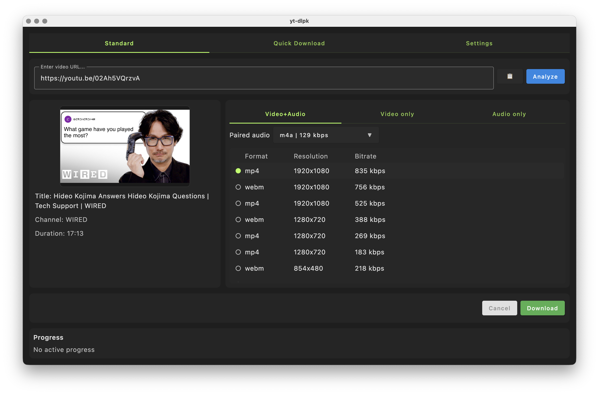

# yt-dlpk

`yt-dlpk` は、動画や音声をシンプルに保存できるデスクトップアプリです。
リンクを貼って、画質/音質を選んで、ダウンロードするだけの流れで使えます。



言語別README:
- [英語](./README.md)
- [日本語](./README.ja.md)
- [韓国語](./README.ko.md)

## できること

- 動画リンクを解析して、タイトル/チャンネル/サムネイルを確認
- 画質・音質ごとにフォーマットを選択
- 動画+音声 / 動画のみ / 音声のみ で保存
- 字幕の保存（対応している場合）
- プレイリスト全体または単体動画の保存
- 保存先フォルダとファイル名ルールの設定
- 進捗確認と途中キャンセル

## 推奨セットアップ

`yt-dlpk` は動作するシステムツールを優先します。不足している `yt-dlp`、`ffmpeg`/`ffprobe`、Deno（YouTube 用 JavaScript ランタイム）は `~/.yt-dlpk/tools/bin` にダウンロードします。実行ファイルはアプリのインストールパッケージには含まれません。初回の準備にはインターネット接続が必要で、macOS では Intel / Apple Silicon に対応するツールを取得します。詳細は[ツール管理](docs/tool-management.md)をご覧ください。

macOS Homebrew:

```sh
brew install yt-dlp ffmpeg deno
```

Windows winget:

```powershell
winget install yt-dlp.yt-dlp
winget install Gyan.FFmpeg
```

Windows Chocolatey:

```powershell
choco install yt-dlp ffmpeg
```

## 使い方

1. アプリを起動します。
2. 保存したい動画URLを貼り付けます。
3. `Analyze` をクリックします。
4. 希望するフォーマット（画質/音質）を選びます。
5. 必要に応じてオプションを設定します。
   - 字幕保存
   - 音声抽出形式
   - プレイリスト全体保存の有無
   - 保存先フォルダ/ファイル名
6. `Download` をクリックして保存を開始します。
7. 進捗を確認し、必要なら途中でキャンセルできます。

## はじめて使う方へ

- まずは短い動画1本で設定を試すのがおすすめです。
- 保存先フォルダを先に決めておくと管理しやすくなります。
- プレイリストURLでは、全体保存の設定を必ず確認してください。

## ログイン・年齢確認が必要な動画

ブラウザでYouTubeにログインし、その動画を再生できることを確認してください。アプリの `設定 > ダウンロードルール > ログイン認証 (Cookie)` で `ブラウザから取得` とログイン中のブラウザを選びます。プロファイルは空欄で自動選択されます。複数ある場合は名前（例: `Profile 1`）またはパスを指定できます。設定は解析・通常ダウンロード・クイックダウンロードに共通です。

取得に失敗する場合は `Cookieファイル` を選び、Netscape形式の `cookies.txt` を指定してください。macOSではキーチェーンへのアクセス許可、Safariではフルディスクアクセスが必要になる場合があります。Windowsではブラウザを完全に終了するとCookieデータベースのロックが解除されることがあります。Chrome/Edgeの暗号化で取得できない場合はFirefoxまたはCookieファイルを使用してください。

初期設定は `使用しない` です。アプリの設定にはブラウザ・プロファイル・ファイルパスだけを保存します。Cookieファイルにはログイン情報が含まれるため、共有やGitへの追加はしないでください。Cookieでアカウントの視聴権限は変わりません。有効期限が切れた場合は再ログインやファイルの更新が必要です。[yt-dlpのFAQ](https://github.com/yt-dlp/yt-dlp/wiki/FAQ#how-do-i-pass-cookies-to-yt-dlp)と[YouTube Cookieの案内](https://github.com/yt-dlp/yt-dlp/wiki/Extractors#exporting-youtube-cookies)も参照してください。

## ローカルビルド

JDK 25 が必要です。

テストを実行:

```sh
./gradlew desktopTest
```

ローカルでアプリを起動:

```sh
./gradlew run
```

現在のOS向けのリリースパッケージをビルド:

```sh
./gradlew packageReleaseDistributionForCurrentOS
```

## 注意

- このアプリは内部的に `yt-dlp` と `ffmpeg` を使って解析とダウンロードを行います。
- 公式サポート対象は Windows と macOS です。
- Linux での実行は保証していません。
- 利用可否は、動画サイト側の対応状況やコンテンツ状態に依存します。
- 年齢制限・地域制限・アクセス権限により保存できない動画があります。
